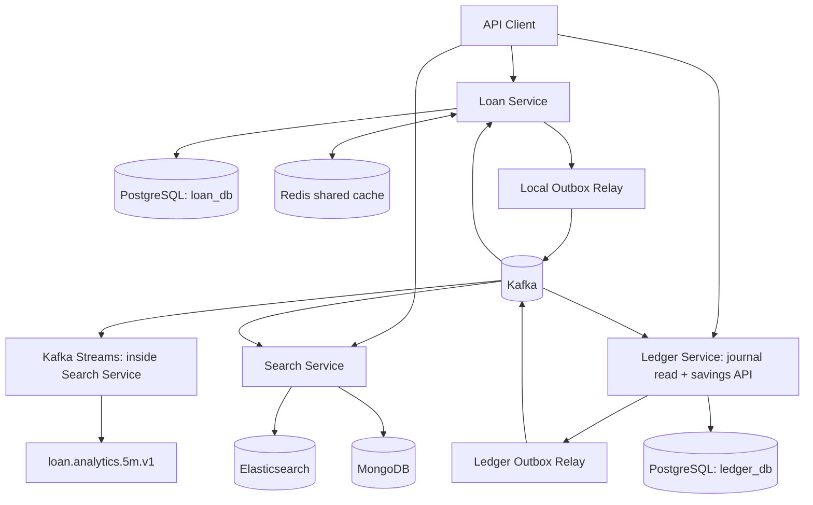

# FinCore — MVP Technical Specification

**Enterprise Financial Services Platform**  
**Document ID:** FC-MVP-SPEC-001  
**Version:** 1.1.0  
**Status:** Implementation Baseline — Expanded Core Financial Flows  
**Date:** 2026-11-17  
**Repository:** `fincore-platform`  
**Language:** Bahasa Indonesia  
**Related documents:** `FINCORE_TECHNICAL_SPECIFICATION.md`, `FINCORE_ALGORITHMS_SPECIFICATION.md`  
**Change summary v1.1.0:** Repayment processing dan rekening tabungan sintetis, tanpa menambah jumlah deployable microservice.

---

## 1. Tujuan

FinCore MVP adalah platform layanan finansial berbasis Java Spring Boot yang membuktikan implementasi **tujuh pilar teknologi** lewat tiga alur bisnis yang saling melengkapi. MVP memprioritaskan kualitas implementasi, keandalan transaksi, demonstrasi failure scenario, dan dokumentasi keputusan arsitektur. Dokumen ini adalah **batas implementasi MVP**; dokumen terkait tetap menjadi referensi perluasan enterprise.

**Tujuh pilar wajib:**

1. Spring IoC.
2. Java Stream.
3. Advanced Native SQL Query.
4. Containerization & Microservices.
5. Kafka & Stream-Based Application.
6. Redis, Caching Strategy & Data Grid.
7. Elasticsearch & Other Non-Relational Databases.

### 1.1 Prinsip ruang lingkup

- **Tepat tiga aplikasi Spring Boot yang dapat di-deploy independen:** `loan-service`, `ledger-service`, `search-service`.
- **Tiga alur bisnis MVP:** (A) pengajuan → persetujuan → pendanaan simulasi → ledger, (B) penjadwalan dan pembayaran cicilan simulasi → ledger → pembaruan outstanding, (C) rekening tabungan sintetis → setoran/penarikan simulasi → ledger. Search dan analytics menerima event yang relevan.
- **Tidak memindahkan layanan menjadi modul internal semata**: tiap service punya proses, kontrak, dan batas data sendiri.
- **Tidak ada transfer dana nyata.** Seluruh data, identitas, pencairan, setoran, penarikan, dan pembayaran cicilan berupa simulasi/sintetis. Tidak ada koneksi core banking eksternal.
- **Tidak ada frontend wajib**; OpenAPI dan collection HTTP cukup untuk demonstrasi.
- **Tidak perlu orchestration kompleks** (Kubernetes, service mesh, multi-region, API gateway terpisah, atau seluruh lifecycle produk keuangan).
- **Komponen tambahan dibatasi:** PostgreSQL, Kafka, Redis, Elasticsearch, MongoDB; seluruhnya mempunyai use case terukur pada tujuh pilar.

### 1.2 Definition of successful MVP

MVP selesai ketika semua requirement berlabel **MUST**, semua acceptance test wajib **AT-01 sampai AT-25**, serta smoke test dari checkout bersih berhasil. Bagian **SHOULD/OPTIONAL** tidak menghalangi penyelesaian MVP.

---

## 2. Requirement Coverage Matrix (Traceability)

| ID | Pilar | MUST: bukti implementasi | Lokasi utama | Acceptance tests |
|---|---|---|---|---|
| R1 | **Spring IoC** | Constructor injection, dua pricing strategy bean, registry/factory, `@Configuration`/`@Bean`, `@Transactional` dengan boundary jelas dan demonstrasi proxy pitfall | `loan-service`, `ledger-service` | AT-01, AT-02, AT-20 |
| R2 | **Java Stream** | `filter`, `map`, `groupingBy`, `reducing`, `sorted`, `limit`; agregasi nominal `BigDecimal` dan top-K deterministik atas dataset terbatas; tambahan laporan cicilan | `loan-service` | AT-03, AT-21 |
| R3 | **Advanced Native SQL** | CTE, `ROW_NUMBER()` window function, running sum, conditional aggregate repayment, parameterized query, indeks, `EXPLAIN (ANALYZE, BUFFERS)`, concurrency guard | `loan-service`, `ledger-service` + PostgreSQL | AT-04, AT-05, AT-21, AT-24 |
| R4 | **Containerization & Microservices** | 3 image Docker multi-stage, health checks, Docker Compose, service boundary, konfigurasi per environment, failure isolation; repayment acknowledgement antarservice | Semua services | AT-06, AT-07, AT-22 |
| R5 | **Kafka & Stream-Based Application** | Producer, consumer group, keyed partition, outbox, inbox idempotency, retry/DLQ **dan Kafka Streams `KStream` windowed aggregation**, repayment acknowledgement dan savings events | Semua services | AT-08, AT-09, AT-10, AT-11, AT-22, AT-25 |
| R6 | **Redis, Caching Strategy & Data Grid** | Cache-aside, TTL+jitter, evict on write, degraded fallback, **shared cache antar dua instance service**, atomic coordination/counter dan kajian consistency/failover; saldo dan pembayaran tidak di-cache secara authoritative | `loan-service` + Redis | AT-12, AT-13, AT-14, AT-24 |
| R7 | **Elasticsearch & Other Non-Relational DB** | Elasticsearch full-text/filter/sort + idempotent event projection **dan MongoDB document projection** dengan index/query nyata; activity repayment juga diproyeksikan | `search-service` | AT-15, AT-16, AT-17, AT-25 |
| CORE | Kualitas finansial | `BigDecimal`, idempotent funding/repayment/savings, jadwal cicilan + alokasi parsial, double-entry journal seimbang, saldo tabungan non-negatif, status/ledger authoritative | `loan-service`, `ledger-service` | AT-18 sampai AT-25 |

**Catatan interpretasi:** “Data Grid” tidak dianggap terpenuhi hanya karena Redis container tersedia: harus ada demonstrasi data/cache bersama lintas instance serta dokumentasi konsistensi dan kegagalan. “Stream-Based Application” juga tidak dianggap terpenuhi hanya karena `@KafkaListener`: harus ada topologi Kafka Streams. Pilar NoSQL tidak dibatasi Elasticsearch saja; MongoDB mempunyai use case dokumenter yang berbeda.

---

## 3. Business Scope & Domain Rules

### 3.1 Use cases MVP

| ID | Use case | Output |
|---|---|---|
| UC-01 | Mendapatkan katalog produk pinjaman | Data `loan_products`, di-cache Redis |
| UC-02 | Menghitung simulasi penawaran bunga | `pricingStrategy`, angsuran/schedule, total bunga |
| UC-03 | Mengajukan pinjaman | Data `loan_applications` dengan `SUBMITTED` |
| UC-04 | Menyetujui pinjaman secara terotorisasi | `APPROVED` satu kali, audit metadata |
| UC-05 | Menjalankan **funding simulator** | `FUNDED` hanya setelah hasil simulasi berhasil dan tersimpan |
| UC-06 | Membukukan pendanaan di Ledger Service | Posted journal dengan debit=credit |
| UC-07 | Mencari dan memfilter pinjaman | Dokumen Elasticsearch (eventually consistent) |
| UC-08 | Melihat riwayat aktivitas pinjaman | Dokumen MongoDB (non-authoritative read model) |
| UC-09 | Laporan teknis agregasi | Stream Top-K, SQL window analytics, Kafka Streams window aggregation |
| UC-10 | Melihat jadwal angsuran | Schedule dengan pokok, bunga, jatuh tempo, outstanding |
| UC-11 | Melakukan pembayaran cicilan simulasi | Payment intent, receipt, alokasi pokok/bunga, posting ledger secara asinkron |
| UC-12 | Melihat riwayat pembayaran cicilan | Riwayat pembayaran dan status posted/pending/failed |
| UC-13 | Membuka rekening tabungan sintetis | Rekening aktif, nomor rekening unik, saldo awal nol |
| UC-14 | Setor dan tarik saldo tabungan simulasi | Setoran/penarikan idempotent, saldo tidak negatif, journal atomik |
| UC-15 | Melihat saldo dan mutasi tabungan | Saldo authoritative dan transaksi mutasi dari ledger DB |

`Customer` direpresentasikan melalui `customerId` sintetik milik data seed. `customer-service`, `payment-service`, `risk-service`, dan `savings-service` terpisah **tidak diperlukan** pada MVP. `loan-service` memiliki repayment business state; `ledger-service` memiliki tabungan dan pembukuan. Pembayaran cicilan dari rekening tabungan (internal transfer antarbatas data) **ditunda** agar tidak perlu membuat saga/debit reservation lintas domain.

### 3.2 State machine

```text
SUBMITTED --approve--> APPROVED --request-funding--> FUNDING_PENDING
    |                     |                                   |
    +----reject--------> REJECTED                   +--------+---------+
                                                     |                  |
                                                 FUNDED          FUNDING_FAILED
```

- Semua transisi memakai state guard; `APPROVED` tidak otomatis berarti dana sudah dicairkan.
- `FUNDED` berarti **simulator mengonfirmasi sukses**, bukan konfirmasi bank sungguhan.
- Event `LoanFunded` dikirim **setelah** state `FUNDED` tercatat pada database bersama outbox.
- Ledger memproses event secara asinkron; keterlambatan journal terlihat lewat status/read model atau endpoint ledger yang terpisah. Tidak boleh mengklaim ledger sudah posted hanya berdasarkan sukses funding simulator.
- Timeout atau keadaan hasil simulasi tidak pasti dibiarkan `FUNDING_PENDING` untuk ditinjau ulang oleh proses rekonsiliasi minimal (status query internal); **jangan melakukan blind retry**.

### 3.2.1 Repayment lifecycle (simulated)

```text
Loan funded + funding journal POSTED
    -> repayment schedule generated
    -> payment requested (PENDING_SIMULATION)
    -> mock payment confirmed (CONFIRMED_AWAITING_LEDGER)
    -> RepaymentConfirmed event via loan outbox
    -> ledger journal posted (RepaymentJournalPosted event)
    -> loan-service settles allocation + marks payment POSTED
    -> schedule/outstanding updated; loan becomes PAID_OFF when fully settled
```

- MVP mendukung **pembayaran cicilan tepat dan parsial**, tanpa denda, biaya keterlambatan, autodebit, atau restrukturisasi. Setiap pembayaran dialokasikan ke **bunga jatuh tempo dahulu, lalu pokok jatuh tempo**, memakai versi policy yang tercatat; pembayaran berlebih ditolak (HTTP 422) untuk membatasi scope.
- Jumlah total payment = jumlah alokasi bunga + pokok; perhitungan menggunakan `BigDecimal`. Sistem menyimpan allocation snapshot pada saat konfirmasi simulasi.
- Untuk mencegah dua pembayaran mengalokasikan outstanding yang sama, **maksimal satu repayment in-flight per loan**; concurrency dijaga dengan row lock/conditional update DB dan unique active-intent guard. Request lain mendapat `409` sampai intent terselesaikan.
- Repayment **baru boleh** diproses setelah jurnal pencairan loan berstatus POSTED (terkonfirmasi melalui event `FundingJournalPosted` dan durable loan projection), bukan ketika funding simulator baru mengembalikan sukses.
- `POSTED` adalah status pembayaran final hanya setelah acknowledgement ledger durable; delay event bukan alasan melakukan posting manual tambahan. Jika acknowledgement tertunda, status tetap pending dan recovery menggunakan query/replay idempotent.
- Ledger journal pembayaran simulasi contoh: **Debit `SIMULATED_SETTLEMENT_CLEARING` sejumlah payment**, **Credit `LOAN_RECEIVABLE` sebesar principal allocation**, **Credit `INTEREST_INCOME` sebesar interest allocation** (contoh policy accounting sederhana, bukan template akuntansi universal).

### 3.2.2 Savings lifecycle (simulated)

```text
Open savings account (ACTIVE, balance = 0)
    -> simulated deposit: journal + balance update in one ledger DB transaction
    -> simulated withdrawal: verify available balance and atomic debit
    -> journal + balance update in same transaction
    -> immutable statement rows / audit events
```

- Rekening tabungan berbasis `customerId` sintetik; currency MVP **IDR saja**. Nomor rekening unik, digenerate internal; status `ACTIVE` atau `FROZEN`. Rekening FROZEN menolak setoran/penarikan sampai dibuka kembali oleh operator berwenang.
- Saldo available disimpan sebagai **materialized balance yang authoritative hanya bila diperbarui atomik bersama jurnal** pada database milik `ledger-service`; jurnal immutable merupakan audit trail. Rekonsiliasi menghitung ulang saldo dari journal lines dan membandingkan proyeksi saldo.
- Setoran/penarikan menghasilkan perpindahan pembukuan sintetis, **bukan transfer uang nyata**. Contoh: deposit: Debit `SIMULATED_CASH_CLEARING`, Credit `SAVINGS_LIABILITY`; withdrawal: Debit `SAVINGS_LIABILITY`, Credit `SIMULATED_CASH_CLEARING`.
- Penarikan harus menolak saldo tidak cukup sebelum posting; transaksi bersamaan harus memakai atomic conditional debit atau `SELECT ... FOR UPDATE` dan unique operation reference.
- Bunga tabungan, biaya administrasi, transfer antarrekening, penutupan rekening, dan pembayaran cicilan dari tabungan **tidak termasuk MVP**.


### 3.3 Financial invariants

1. Nominal uang menggunakan `BigDecimal`, PostgreSQL `NUMERIC(19,4)`, satu kebijakan pembulatan terdokumentasi; `float`/`double` dilarang untuk nominal.
2. Total pokok pada jadwal angsuran sama dengan nilai pinjaman; sisa pembulatan diselesaikan pada periode akhir.
3. Pendanaan memiliki idempotency key + unique business reference yang ditegakkan di database.
4. Satu `loanId` tidak boleh menyebabkan dua journal posting normal untuk pendanaan yang sama.
5. Setiap jurnal posted memiliki total debit **sama dengan** total kredit per currency; koreksi dilakukan lewat reversal, bukan edit historis.
6. Redis, Elasticsearch, MongoDB, dan Kafka Streams **bukan** sumber otoritatif nilai uang, keputusan approval, status funding, atau saldo tabungan.
7. Tidak ada repayment `POSTED` tanpa jurnal ledger terkait yang `POSTED`; duplicate event tidak boleh menggandakan alokasi pokok/bunga atau journal.
8. Saldo tabungan tidak boleh negatif; balance update dan jurnal harus commit/rollback atomik; deposit/withdraw tidak bisa mengubah ledger dua kali untuk operasi yang sama.
9. `funding`, `repayment`, `savings-deposit`, dan `savings-withdraw` membutuhkan idempotency key, business reference unik, audit metadata, dan otorisasi.

---

## 4. Architecture & Service Boundaries



**Deployment:** tepat tiga aplikasi Spring Boot. Kafka Streams merupakan komponen/topologi di dalam `search-service`, bukan aplikasi keempat. Dua PostgreSQL **logical databases** boleh berada dalam satu PostgreSQL container untuk pengembangan; kredensial dan hak akses tetap dipisah. `search-service` tidak boleh mengakses tabel pinjaman atau ledger secara langsung.

### 4.1 Owner dan kontrak

| Service | Owns | Input/Output | Tidak bertanggung jawab atas |
|---|---|---|---|
| `loan-service` | Katalog produk, kalkulasi, aplikasi, funding simulation, **repayment schedules, payment intents, allocation/outstanding**, outbox | REST + loan/repayment domain events; consumes ledger acknowledgements | Jurnal akuntansi, savings balances, dan search index |
| `ledger-service` | Journal headers/lines, inbox dedupe, **savings accounts + atomic balances**, ledger outbox | Loan funded/repayment events → journal; savings REST → journal + balance; ledger ack events | Status aplikasi dan jadwal cicilan |
| `search-service` | Elasticsearch index, MongoDB loan/repayment activity view, Kafka Streams analytics | Loan/repayment events → projections; loan funding events → stream topology | Keputusan finansial dan saldo tabungan |

### 4.2 Teknis baseline

- Java 21 LTS; Spring Boot versi stabil yang kompatibel dan **dipin** di build, bukan `latest`.
- Maven multi-module (parent BOM / dependency management).
- Spring Web, Spring Validation, Spring Data JPA, Spring JDBC, Spring Kafka, Kafka Streams, Spring Data Redis, Spring Data Elasticsearch, Spring Data MongoDB.
- PostgreSQL, Flyway, Redis, Kafka broker mode modern yang dipilih secara konsisten dalam Compose, Elasticsearch, MongoDB.
- JUnit 5, Mockito, Testcontainers, Spring Boot Test; OpenAPI; Actuator/Micrometer untuk health dan metrics.
- Minimal Spring Security: API write terproteksi dan role `LOAN_OPERATOR` vs `LOAN_APPROVER`; identitas/test token hanya untuk local development. Rahasia tidak di-commit dan authorization harus diuji.

**Tidak diwajibkan:** Keycloak server terpisah, API gateway, Kubernetes, service mesh, Redis Cluster, tracing stack penuh, ML scoring, pembayaran real-time, UI produksi.

---

## 5. Pilar 1 — Spring IoC (MUST)

### Requirement

- `InterestCalculationStrategy` dengan minimal dua implementasi bean: `FlatInterestStrategy` dan `AnnuityInterestStrategy`.
- `LoanPricingService` menerima `List<InterestCalculationStrategy>` melalui **constructor injection**, membentuk registry immutable berdasarkan enum jenis bunga, dan menolak duplikasi strategi saat bootstrap.
- Gunakan `@Configuration`/`@Bean` untuk setidaknya satu bean infrastruktur (misalnya `Clock`/`BusinessCalendar`) dan `@ConfigurationProperties` dengan validasi untuk policy pinjaman.
- Aplikasi memiliki setidaknya satu unit test yang menjelaskan `@Qualifier`/`@Primary` atau resolusi multi-bean tanpa ambiguitas.
- `@Transactional` berada di application service, bukan controller. Pemanggilan lintas proxy harus benar, tidak mengandalkan self-invocation untuk transaksi baru.
- Stateless singleton beans; tidak ada mutable state request pada singleton.

### Acceptance evidence

- `LoanPricingService` memilih implementasi sesuai konfigurasi `interestType` secara deterministik.
- Unit test strategi dengan `BigDecimal` (bunga nol, tenor invalid, pembulatan, residual).
- Test transaksi membuktikan rollback ketika penyimpanan state/outbox gagal; dokumentasi singkat menjelaskan self-invocation pitfall.

---

## 6. Pilar 2 — Java Stream (MUST)

**Use case:** report `Top 5 customers by funded principal` dari list hasil query yang dibatasi (misalnya maksimal 1.000 record pada endpoint demo). Tambahan laporan demo: `Top 5 loans by completed repayment amount` dengan filter `POSTED`, grouping dan tie-breaker deterministik; jangan menghitung seluruh loan dari dataset tak dibatasi di heap.

- Wajib mempraktikkan `filter`, `map`, `Collectors.groupingBy`, `Collectors.reducing` dengan `BigDecimal::add`, `sorted`, dan `limit`.
- Hasil deterministik: ranking `amount DESC`, kemudian `customerId ASC` sebagai tie-breaker.
- Dataset kosong menghasilkan list kosong, bukan exception; amount negatif yang invalid ditolak sebelum kalkulasi.
- Tidak menggunakan `parallelStream()` tanpa benchmark dan pembuktian thread safety.
- Laporan besar dipindahkan ke SQL agar jutaan baris tidak dimuat ke JVM heap; dokumentasikan alasan pemisahan use case.

**Artefak:** `LoanAnalyticsService#topCustomersFromBoundedDataset(...)`, `LoanAnalyticsService#topRepaidLoansFromBoundedDataset(...)`, unit test data kosong, duplikat, tie, dan BigDecimal presisi.

---

## 7. Pilar 3 — Advanced Native SQL Query (MUST)

SQL harus ditulis sebagai native, terparameterisasi, dieksekusi terhadap PostgreSQL, dan diberi penjelasan query plan.

### Query A — Top 3 funded loans per customer

```sql
WITH ranked_loans AS (
  SELECT
    id, customer_id, principal_amount, funded_at,
    ROW_NUMBER() OVER (
      PARTITION BY customer_id
      ORDER BY principal_amount DESC, id ASC
    ) AS rn
  FROM loans
  WHERE status = 'FUNDED'
    AND funded_at >= :from_time
    AND funded_at < :to_time
)
SELECT id, customer_id, principal_amount, funded_at
FROM ranked_loans
WHERE rn <= 3
ORDER BY customer_id, rn;
```

### Query B — Running funded total per product

```sql
SELECT
  id, product_code, funded_at, principal_amount,
  SUM(principal_amount) OVER (
    PARTITION BY product_code
    ORDER BY funded_at, id
    ROWS BETWEEN UNBOUNDED PRECEDING AND CURRENT ROW
  ) AS running_principal
FROM loans
WHERE status = 'FUNDED'
  AND funded_at >= :from_time
  AND funded_at < :to_time;
```

**Persyaratan tambahan:**

- Sertakan query dengan `JOIN` dan conditional aggregate (`SUM(...) FILTER (WHERE ...)` atau `CASE WHEN`) pada `loans`, `repayments`, dan/atau `repayment_allocations` untuk menghitung principal dan interest yang telah `POSTED` per loan. Gunakan `CTE` dan window function untuk ranking jika sesuai.
- Bandingkan indeks yang masuk akal berdasarkan pola `WHERE`/`JOIN`/`ORDER BY`, lalu dokumentasikan output `EXPLAIN (ANALYZE, BUFFERS)` dari dataset sintetis representatif. Tidak perlu mengklaim penggunaan index sebelum ada bukti plan.
- Gunakan `UPDATE ... WHERE status = ... AND version = ...` untuk optimistic concurrency; jika affected row `0`, kembalikan conflict, bukan memaksa status.
- `ORDER BY` dinamis harus dari allowlist kolom; semua nilai lainnya memakai parameter binding.
- Tidak ada query lintas database milik service lain.

**Artefak:** `sql/reports/*.sql`, migration indeks, report `docs/sql-performance.md`, integration tests (hasil data dan transisi paralel termasuk dua withdrawal bersamaan).

---

## 8. Pilar 4 — Containerization & Microservices (MUST)

- Dockerfile **multi-stage** untuk ketiga aplikasi; runtime dijalankan sebagai non-root user.
- Root `compose.yaml` menyediakan PostgreSQL, Kafka, Redis, Elasticsearch, MongoDB, tiga Spring services, serta health checks dan readiness dependency yang diperlukan.
- Tidak ada kebutuhan service discovery atau API gateway terpisah. Antarservice berkomunikasi melalui event Kafka; endpoint REST exposed untuk use case langsung.
- Configuration via environment variables; sample `.env.example`, secrets tidak disimpan dalam repository.
- `/actuator/health/readiness` dan `/actuator/health/liveness` atau health endpoint setara disediakan.
- Jalankan `loan-service` dalam **dua instance** untuk skenario data-grid Redis (dapat melalui compose profile/override agar default tetap ringan).
- Saat `search-service` down, write loan tetap bisa commit + persist outbox. Jika Kafka down, outbox tertahan dan pulih setelah broker tersedia, tanpa kehilangan perubahan loan/repayment/savings. Savings ledger lokal tetap atomik meski Kafka untuk projection sedang offline.

**Minimum command:** `docker compose up --build -d`; automated smoke script memvalidasi status container, seed, API, event, funding, repayment, savings, dan projections setelah dependensi sehat.

---

## 9. Pilar 5 — Kafka & Stream-Based Application (MUST)

### 9.1 Event contract

Satu topic domain `fincore.loan.events.v1` memakai `loanId` sebagai Kafka key; setiap event mempunyai envelope berversi:

```json
{
  "eventId": "018f0000-0000-7000-8000-000000000001",
  "eventType": "LoanFunded",
  "schemaVersion": 1,
  "aggregateId": "loan-001",
  "aggregateVersion": 4,
  "occurredAt": "2026-11-17T03:00:00Z",
  "correlationId": "corr-001",
  "payload": {
    "customerId": "customer-001",
    "productCode": "STANDARD",
    "principalAmount": "15000000.0000",
    "currency": "IDR"
  }
}
```

**Peristiwa minimum:** `LoanSubmitted`, `LoanApproved`, `LoanFunded`, `RepaymentConfirmed`, `FundingJournalPosted`, `RepaymentJournalPosted`, `SavingsDepositPosted`, `SavingsWithdrawalPosted`. Loan Service menerbitkan domain loan/repayment events ke `fincore.loan.events.v1`, Ledger Service menerbitkan acknowledgement ke `fincore.ledger.events.v1`; savings events juga berasal dari Ledger outbox. Event `LoanFunded` hanya setelah simulasi pendanaan sukses secara durable; field nominal diserialisasi sebagai **string decimal**, bukan JSON floating-point. Setiap event wajib mengandung `eventId`, `aggregateId`, `aggregateVersion` (sesuai domain owner), `businessReference`, `occurredAt`, `correlationId`. Tidak ada data pribadi sensitif dalam payload.

### 9.2 Reliable publishing & consumption

- `loan-service`: tulis perubahan bisnis dan `outbox_events` dalam **satu transaksi PostgreSQL**.
- Outbox relay melakukan publish asinkron. Crash setelah publish sebelum mark-sent boleh menyebabkan publikasi ulang. Untuk MVP, worker tunggal untuk aggregate terkait atau serial per key menjaga urutan; tidak mengklaim exactly-once antar-DB dan Kafka.
- `ledger-service`: `processed_events(event_id)` memiliki unique constraint; dedupe + journal insert berada dalam satu transaksi lokal. Commit offset **setelah** commit DB. Replay tidak menghasilkan journal tambahan.
- `ledger-service` menerbitkan `FundingJournalPosted` / `RepaymentJournalPosted` melalui **ledger outbox** yang atomik dengan journal posting. `loan-service` mengonsumsi acknowledgement menggunakan `processed_events`/inbox sendiri, lalu mengubah repayment dan outstanding dalam satu transaksi loan DB.
- Setoran/penarikan tabungan diselesaikan lokal di ledger DB (balance + journal + outbox) dalam satu transaksi. Kafka hanya mendistribusikan event setelah commit; tidak dipakai untuk menjamin saldo tersimpan.
- Consumer menggunakan retry terbatas dengan backoff; pesan yang tetap gagal menuju DLQ berisi metadata diagnosis dan mekanisme replay terkontrol.
- Topic loan/repayment memakai key `loanId` untuk ordering per loan; topic ledger memakai key `loanId` untuk journal acknowledgement loan, atau `accountId` untuk savings events. Consumer memvalidasi version/transisi per aggregate dan unique `businessReference` untuk mendeteksi stale/duplicate event. Versi dari aggregate berbeda tidak dibandingkan secara lintas-domain.

### 9.3 Kafka Streams **wajib, bukan optional**

Di `search-service`, implementasikan topologi:

```text
fincore.loan.events.v1
    -> filter(eventType == LoanFunded)
    -> deduplicate(eventId) using bounded persistent state store
    -> selectKey(productCode)
    -> groupByKey()
    -> windowedBy(tumbling event-time window 5 minutes + grace period)
    -> aggregate(count, totalPrincipal BigDecimal)
    -> to("fincore.loan.analytics.5m.v1")
```

- Serde harus mempertahankan presisi decimal dan mendukung key/window yang sesuai.
- Tetapkan timestamp extractor berbasis `occurredAt` dan kebijakan grace/late record; jelaskan perbedaan event-time vs processing-time.
- Dedup `eventId` perlu retention terbatas yang terdokumentasi; event sangat terlambat diperlakukan sesuai late-event policy. Jika storage dedup expired, jangan mengklaim hasil bebas duplikat tanpa batas waktu.
- Agregasi adalah **analytics projection**, bukan angka authoritative untuk keputusan dana.
- Tambahkan test menggunakan `TopologyTestDriver` untuk event ganda, pengelompokan produk, akhir window, dan late event.

---

## 10. Pilar 6 — Redis, Caching Strategy & Data Grid (MUST)

### 10.1 Caching

**Target:** katalog `loan_products`, bukan state dana, repayment, savings balance, atau journal.

- **Cache-aside:** read cache → miss baca PostgreSQL → populate cache.
- Key versi: `fincore:loan:product:{code}:v1`, TTL default contoh 5 menit + random jitter kecil.
- Perubahan produk: commit PostgreSQL, lalu evict/invalidate; TTL sebagai batas stale ketika invalidation gagal. Dokumentasikan race condition cache population vs update.
- Redis outage: fetch ke PostgreSQL secara aman dengan timeout terukur; tidak mengembalikan approval/funding yang diasumsikan sukses.
- Hindari cache stampede dengan bounded single-flight pada miss populer (lokal instance atau koordinasi aman), dan buktikan perilaku lewat concurrent requests.

### 10.2 Data-grid / shared-state demonstration

Redis berfungsi sebagai shared in-memory data layer antarbeberapa instance aplikasi. **Wajib**:

1. Jalankan `loan-service-a` dan `loan-service-b` dengan Redis sama.
2. Lakukan warm cache pada instance A, lalu baca melalui B; buktikan shared key dan perilaku cache hit tanpa memperlakukan Redis sebagai DB utama.
3. Update produk lewat A; verifikasi B membaca versi baru setelah invalidation / policy freshness yang disepakati.
4. Demonstrasikan atomic `INCR`/Lua untuk counter non-finansial (contoh: request metric/rate-limit counter); bandingkan dengan non-atomic read-modify-write.
5. Dokumentasikan replication, partitioning/sharding, eviction, consistency, dan failover: **demonstrasi cluster/failover penuh tidak wajib**. Jelaskan Redis bukan ledger database dan tidak menjamin ACID lintas microservices. Untuk saldo tabungan dan outstanding cicilan, Redis bukan sumber authority dan dilarang dipakai sebagai guard penarikan.

**Bukan scope:** Redis Cluster multi-node produksi, distributed financial lock sebagai satu-satunya penjaga uang, cache authoritative balance.

---

## 11. Pilar 7 — Elasticsearch & Other Non-Relational DB (MUST)

### 11.1 Elasticsearch: search projection

- Index `fincore-loans-v1`, `loanId` sebagai document `_id`.
- Field mapping eksplisit: `customerId` dan `productCode` sebagai `keyword`, `status` sebagai `keyword`, `principalAmount` sebagai numeric sesuai kebutuhan analytics (tanpa menjadikannya buku besar), `submittedAt`/`fundedAt` sebagai `date`, `description` sebagai `text`.
- Indexer konsumsi domain events; upsert idempotent berbasis `aggregateVersion` untuk mengabaikan stale events dan aman saat replay.
- Search endpoint: free-text pada description, filter `status`/`productCode`, sort stabil, pagination dibatasi; index recovery melalui replay/rebuild path.
- Jelaskan eventual consistency: sukses `POST /loans` tidak berarti dokumen langsung searchable.

### 11.2 MongoDB: non-relational document projection (bukan sekadar teori)

Satu collection **`loan_activity_views`** di `search-service`, berbasis event yang sama tetapi fungsi berbeda dari Elasticsearch.

```json
{
  "loanId": "loan-001",
  "lastAggregateVersion": 4,
  "currentStatus": "FUNDED",
  "activities": [
    {"eventId": "evt-1", "type": "LoanSubmitted", "at": "2026-11-17T01:00:00Z"},
    {"eventId": "evt-2", "type": "LoanFunded", "at": "2026-11-17T03:00:00Z"}
  ]
}
```

- Unique index pada `loanId`; document upsert memakai version guard dan deduplikasi `eventId`; daftar aktivitas dibatasi atau dipaginasi agar ukuran dokumen tidak terus bertambah.
- Event `RepaymentConfirmed`/`RepaymentJournalPosted` dapat ditambahkan sebagai aktivitas dalam MongoDB loan activity view, dengan deduplikasi `eventId` dan batas ukuran dokumen.
- Endpoint `GET /api/v1/loans/{id}/activity` membaca MongoDB projection.
- Test untuk indexed lookup, replay tanpa duplicate activity, dan kesenjangan versi event.
- MongoDB dan Elasticsearch adalah **read models**; keduanya dapat dibangun ulang dari riwayat event yang tersedia atau sumber authoritative menggunakan mekanisme rebuild yang terencana. Retensi Kafka harus diperhitungkan: tidak boleh mengklaim replay dari Kafka selamanya jika topic tidak menyimpan semua event historis.
- **Tidak ada business state mutating operation yang diotorisasi berdasarkan dokumen MongoDB.**

**Alasan dua datastore:** Elasticsearch untuk full-text relevance/aggregation; MongoDB untuk document-shaped activity projection. Tidak perlu membuat microservice tambahan.

---

## 12. Data Model & Ownership

### 12.1 `loan_db` (loan-service)

- `loan_products(id, code UNIQUE, interest_type, annual_rate, min_amount, max_amount, active, version, updated_at)`.
- `loan_applications(id, customer_id, product_code, principal_amount, tenor_months, status, version, created_at, approved_at, ...)`.
- `loans(id, application_id UNIQUE, customer_id, product_code, principal_amount, status, funded_at, version, ...)`.
- `idempotency_records(id, caller_scope, operation, idem_key, request_fingerprint, result_ref, status, ...)` dengan UNIQUE `(caller_scope, operation, idem_key)`.
- `outbox_events(event_id PRIMARY KEY, aggregate_id, aggregate_version, event_type, payload, status, created_at, ...)`.
- `loan_audit_events(id, actor_id, action, entity_id, created_at, ...)`.
- `repayment_schedules(id, loan_id, installment_no, due_date, principal_due, interest_due, principal_paid, interest_paid, status, version, ...)` dengan UNIQUE `(loan_id, installment_no)`.
- `repayments(id, loan_id, business_ref UNIQUE, amount, status, simulated_receipt_ref UNIQUE, ledger_ref, idem_key, created_at, posted_at, ...)`.
- `repayment_allocations(id, repayment_id, schedule_id, principal_amount, interest_amount, ...)` dengan check nonnegative; satu payment in-flight per loan melalui guarded state/partial unique index yang didefinisikan eksplisit.
- `loan_processed_events(event_id PRIMARY KEY, processed_at, ...)` untuk deduplikasi acknowledgement dari Ledger.
- `loan_db` hanya memutakhirkan `principal_paid/interest_paid` setelah `RepaymentJournalPosted` yang valid; one-pending-payment guard menutup race alokasi.

### 12.2 `ledger_db` (ledger-service)

- `journal_entries(id, business_tx_ref UNIQUE, status, currency, created_at, ...)`.
- `journal_lines(id, entry_id, account_code, side, amount NUMERIC(19,4), ...)`.
- `processed_events(event_id PRIMARY KEY, processed_at, ...)`.
- `savings_accounts(id, account_no UNIQUE, customer_id, currency, status, current_balance NUMERIC(19,4), version, created_at, ...)` dengan CHECK `current_balance >= 0`; `current_balance` diperbarui atomik dalam transaksi yang sama dengan ledger journal.
- `savings_transactions(id, account_id, business_ref UNIQUE, operation_type, amount, balance_after, journal_id UNIQUE, created_at, ...)`, referensi ke posted journal.
- `ledger_idempotency_records(caller_scope, operation, idem_key, request_fingerprint, result_ref, status, ...)` dengan UNIQUE `(caller_scope, operation, idem_key)` untuk savings API.
- `ledger_outbox_events(event_id PRIMARY KEY, aggregate_id, event_type, payload, status, created_at, ...)` untuk journal acknowledgement dan savings events.
- Ledger invariant divalidasi saat posting dalam transaksi database, dibantu constraint pada tabel dan test concurrency.
- Illustrative chart of accounts untuk funding simulation: debit `LOAN_RECEIVABLE`, credit `SIMULATED_SETTLEMENT_CLEARING`. Nama dan pemetaan akun adalah contoh, bukan standar akuntansi yang diklaim final.

### 12.3 Search/non-relational stores

- Elasticsearch: index `fincore-loans-v1`.
- MongoDB: collection `loan_activity_views`.
- Redis: product cache/counter bersama dengan namespace `fincore:*`.
- Kafka: `fincore.loan.events.v1`, `fincore.ledger.events.v1`, `fincore.loan.analytics.5m.v1`, dan DLQ sesuai consumer.

Tidak ada cross-service foreign key atau akses write ke database milik service lain.

---

## 13. Minimal API Contracts

| Method | Path | Owner | Fungsi |
|---|---|---|---|
| `GET` | `/api/v1/loan-products` | Loan | Katalog dari cache-aside |
| `POST` | `/api/v1/loans/quotes` | Loan | Quote menggunakan Spring strategy |
| `POST` | `/api/v1/loans/applications` | Loan | Submit idempotent |
| `POST` | `/api/v1/loans/applications/{id}/approve` | Loan | Status guard + role approver |
| `POST` | `/api/v1/loans/applications/{id}/fund` | Loan | Sandbox funding only; idempotent |
| `GET` | `/api/v1/loans/{id}` | Loan | Authoritative application/loan state |
| `GET` | `/api/v1/reports/loans/top-customers` | Loan | Demo Java Stream over bounded dataset |
| `GET` | `/api/v1/reports/loans/top-three` | Loan | Native SQL window ranking |
| `GET` | `/api/v1/reports/loans/running-total` | Loan | Native SQL running sum |
| `GET` | `/api/v1/journals/by-business-ref/{ref}` | Ledger | Status jurnal untuk verification |
| `GET` | `/api/v1/search/loans` | Search | Search/filter/sort ES |
| `GET` | `/api/v1/loans/{id}/activity` | Search | MongoDB activity projection |
| `GET` | `/api/v1/analytics/loans/funded-5m` | Search | Query hasil Kafka Streams projection/read model |
| `GET` | `/api/v1/loans/{id}/repayment-schedule` | Loan | Jadwal cicilan dan outstanding |
| `POST` | `/api/v1/loans/{id}/repayments` | Loan | Konfirmasi pembayaran cicilan sintetis; async until ledger ack |
| `GET` | `/api/v1/loans/{id}/repayments` | Loan | Riwayat dan status pembayaran cicilan |
| `POST` | `/api/v1/savings/accounts` | Ledger | Buka rekening tabungan sintetis |
| `GET` | `/api/v1/savings/accounts/{id}` | Ledger | Detail rekening dan saldo authoritative |
| `POST` | `/api/v1/savings/accounts/{id}/deposits` | Ledger | Setoran sintetis idempotent dan journal atomik |
| `POST` | `/api/v1/savings/accounts/{id}/withdrawals` | Ledger | Tarik saldo sintetis dengan nonnegative concurrency guard |
| `GET` | `/api/v1/savings/accounts/{id}/transactions` | Ledger | Mutasi/statement dengan cursor-based pagination |

- API write menerima correlation ID dan `Idempotency-Key` wajib untuk funding, repayment, savings deposit dan withdrawal. Validation errors: `400/422` (termasuk saldo tak cukup/nominal tak valid); unauthorized: `401/403`; version/idempotency conflict: `409`; accepted async action: `202` ketika masih pending. `GET` saldo harus mengambil dari Ledger DB, bukan Redis atau read model.
- Akses savings account/loan harus disaring berdasarkan `customerId` principal atau role operator yang berwenang; parameter ID dari client saja bukan bukti hak akses. Gunakan identitas sintetis pada local demo.
- Error response terstruktur: `code`, `message`, `correlationId`, `timestamp`. Jangan mengekspos stacktrace atau data sensitif.
- Schema request/response definitif diterbitkan lewat OpenAPI; tabel ini adalah kontrak level arsitektur.

### 13.1 Contoh kontrak request (synthetic, draft)

**Repayment:** `POST /api/v1/loans/{id}/repayments`, header `Idempotency-Key: repay-demo-001`.

```json
{
  "amount": "750000.0000",
  "currency": "IDR",
  "simulatedPaymentReference": "MOCK-RCP-001"
}
```

Respons pertama **`202 Accepted`** dengan `repaymentId`, `status: "CONFIRMED_AWAITING_LEDGER"`, dan `correlationId`. Setelah event `RepaymentJournalPosted` diproses, status berubah menjadi `POSTED`; outstanding dan jadwal angsuran berubah **hanya sekali**.

**Open savings account:** `POST /api/v1/savings/accounts` (auth operator/customer synthetic identity):

```json
{
  "customerId": "customer-001",
  "currency": "IDR"
}
```

**Savings deposit / withdrawal:** `POST /api/v1/savings/accounts/{id}/deposits` atau `/withdrawals`, header `Idempotency-Key` wajib.

```json
{
  "amount": "1000000.0000",
  "currency": "IDR",
  "simulatedExternalReference": "MOCK-SAV-001"
}
```

- Pada transaksi savings yang valid, respons mengandung `savingsTransactionId`, `journalId`, `balanceAfter`, dan `status: "POSTED"`; semua berasal dari commit transaksi lokal yang sama. Kegagalan journal mengakibatkan **rollback** balance update dan savings transaction.
- Transaksi dengan idempotency key sama + payload sama mengembalikan hasil operation yang sama; key sama + payload berbeda → `409 Conflict`. Permintaan bersamaan ditangani dengan DB serialization/locking, bukan mengandalkan Redis.
- Untuk tabungan: batas transaksi sintetis, batas nominal dan scale `NUMERIC(19,4)`, akses pelanggan, serta state `ACTIVE/FROZEN` divalidasi di domain service. Saldo dapat direkonsiliasi dari posted journal untuk akun liability terkait.
- Mutasi rekening memakai keyset pagination `(created_at, id)` agar urutan stabil ketika data bertambah.

---

## 14. Test Plan & Acceptance Criteria

Semua skenario **AT-01 sampai AT-25** wajib memiliki test otomatis atau script demonstrasi repeatable, serta bukti hasil di `docs/evidence/`. Pengukuran performance adalah baseline lingkungan lokal, **bukan klaim angka produksi**.

| ID | Pilar | Skenario | Kriteria lulus |
|---|---|---|---|
| AT-01 | Spring IoC | Dua jenis bunga dipilih via DI registry | Bean tepat, hasil numerik sesuai golden examples; invalid strategy ditolak |
| AT-02 | Spring IoC | Exception pada local financial transaction | State + outbox rollback atomik; proxy/self-invocation case terdokumentasi |
| AT-03 | Java Stream | Filter + group + Top 5 pada empty/tie/duplicates | `BigDecimal` akurat, urutan deterministik, tidak memuat seluruh dataset besar |
| AT-04 | SQL | CTE, Top-3, running sum, conditional aggregate | Hasil cocok fixture; `EXPLAIN` tersimpan dan dibahas |
| AT-05 | SQL/concurrency | Dua approve/fund request paralel | Tepat satu transisi final valid dan satu funding business reference |
| AT-06 | Docker | Clean checkout lalu Compose + seed + smoke | Tiga services dan seluruh datastore required healthy; happy path bekerja |
| AT-07 | Microservices | Search service dihentikan saat aplikasi dibuat | Loan tetap durable; search projection mengejar setelah recovery |
| AT-08 | Kafka | DB state commit, publish ke broker gagal sementara | Outbox tetap pending lalu sukses publish setelah recovery |
| AT-09 | Kafka | Ledger crash setelah DB commit sebelum offset commit | Redelivery tidak menduplikasi journal |
| AT-10 | Kafka | Poison event | Bounded retry + DLQ terobservasi; consumer dapat melanjutkan pesan berikutnya |
| AT-11 | Kafka Streams | 5-min window aggregate, duplicate, late record | Correct grouping, exact decimal, dedupe dalam retention, late policy terbukti |
| AT-12 | Redis cache | Miss, hit, update invalidate, expiry | Data produk benar menurut documented freshness policy |
| AT-13 | Redis data grid | Dua instance Loan berbagi key dan menjalankan atomic counter | Shared-state observable; tidak lost-update pada operasi atomic |
| AT-14 | Redis resilience | Redis tidak tersedia dan cache stampede | Fallback DB untuk produk berhasil; finansial tetap benar; concurrency dibatasi |
| AT-15 | Elasticsearch | Full-text + filter + stable sort | Hasil sesuai mapping dan fixture; reindex dapat dijalankan |
| AT-16 | MongoDB | Indexed activity lookup + duplicate event | Aktivitas konsisten, event tidak berulang, stale version diabaikan |
| AT-17 | Read-model resilience | Search/MongoDB tertunda, replay/rebuild | State authoritative tetap utuh dan projection dapat pulih |
| AT-18 | Financial | Jadwal bunga dan balanced journal | Semua monetary invariants terpenuhi, pembulatan valid |
| AT-19 | Financial/idempotency | Retry funding + event replay | Tidak ada duplicate funding reference atau duplicate ledger posting |
| AT-20 | Repayment schedule | Flat/annuity schedule, akhir bulan, pembulatan | Σprincipal = principal pinjaman, residual terakhir tepat, due date deterministik |
| AT-21 | Repayment allocation + SQL | Cicilan parsial; bunga lalu pokok; SQL `JOIN` dan conditional aggregation | Σalokasi = payment, tidak ada double allocation, laporan SQL dan Stream sesuai fixtures |
| AT-22 | Kafka repayment acknowledgement | Crash setelah ledger journal commit sebelum offset; ack tertunda/replayed | Repayment final `POSTED` hanya sekali setelah ack; outstanding tidak berubah dua kali; pending dapat dipulihkan |
| AT-23 | Savings deposit/withdraw | Open account, deposit, withdraw, insufficient funds | Saldo dan journal atomik, total debit=kredit, tidak bisa negatif |
| AT-24 | Savings concurrency & idempotency | Dua withdrawal paralel + retry key sama; Redis down | Tidak overspend; satu posting per operasi; saldo authoritative tetap benar |
| AT-25 | Savings events + recovery | Ledger outbox tertunda, consumer replay, loan repayment timeline | Event tidak hilang/berulang efeknya; search activity konsisten; statement ledger tetap benar |

**Test layers:** JUnit 5 pure-domain unit tests, Spring slice tests, PostgreSQL/Kafka/Redis/Elasticsearch/MongoDB integration tests melalui Testcontainers (test suite dipisahkan menurut dependency), Kafka Streams `TopologyTestDriver`, dan `scripts/smoke.sh` untuk Compose end-to-end.

**Minimum evidence:** test result ringkas, output `EXPLAIN`, contoh event + DLQ, log idempotent replay, cache hit/miss di dua replica, search/MongoDB projection, repayment/ledger acknowledgement, concurrent savings withdrawal, statement reconciliation, dan `docker compose ps` dari stack sehat.

---

## 15. Implementation Plan (Timeboxed by Deliverables, Not Calendar)

### Milestone M1 — Domain foundation

- Repository Maven, tiga Spring Boot skeleton, base compose, migration PostgreSQL.
- Loan products, pricing strategies, approval state guard, idempotency, Java Stream report.
- Native SQL CTE + ranking + running sum + query plan.
- **Exit:** AT-01 sampai AT-05 dan AT-18 bagian kalkulasi hijau.

### Milestone M2 — Distributed transaction/event flow

- Loan outbox relay, Kafka keyed topics, ledger inbox deduplication, balanced journal.
- Funding simulator, failure injection publish/consume, retry/DLQ.
- **Exit:** AT-08 sampai AT-10, AT-19, AT-18 ledger hijau.

### Milestone M3 — Read model + stream analytics

- Search service Elasticsearch mapping, MongoDB activity projection, Kafka Streams 5-minute topology.
- Version guard, dedupe, late record policy, reindex/recovery.
- **Exit:** AT-11, AT-15 sampai AT-17 hijau.

### Milestone M4 — Distributed cache & packaging

- Redis cache-aside, invalidation, TTL+jitter, two-instance data-grid demo, atomic counter.
- Compose clean startup, readiness, smoke test, minimal security hardening, README.
- **Exit:** AT-06, AT-07, AT-12 sampai AT-14; seluruh acceptance matrix hijau.

### Milestone M5 — Repayment & Savings Expansion (added v1.1.0)

- `loan-service`: repayment schedule, partial repayment allocation, mocked receipt confirmation, guarded one-pending-payment workflow, acknowledgement consume + outbox.
- `ledger-service`: incoming repayment journal, ledger acknowledgement outbox, rekening tabungan sintetis, deposit/withdraw dengan balance + double-entry journal dalam satu local DB transaction.
- `search-service`: activity tambahan untuk repayment events; savings event hanya metadata non-PII bila diperlukan observability. Kafka Streams funded-loan aggregate tetap scope utama.
- Test double submit repayment, ack replay, dua withdrawal bersamaan, insufficient balance, rollback pada ledger failure, plus repayment SQL JOIN/aggregation.
- **Exit:** AT-20 sampai AT-25 hijau; seluruh AT-01..AT-19 tetap hijau (regression). Tidak ada service keempat.

Milestone boleh dikerjakan iteratif; jangan menambah fitur baru sebelum acceptance criteria milestone terkait lulus.

---

## 16. Suggested Repository Structure

```text
fincore-platform/
├── pom.xml
├── compose.yaml
├── .env.example
├── README.md
├── services/
│   ├── loan-service/
│   │   ├── pom.xml
│   │   └── src/{main,test}/...
│   ├── ledger-service/
│   │   ├── pom.xml
│   │   └── src/{main,test}/...
│   └── search-service/
│       ├── pom.xml
│       └── src/{main,test}/...
├── infrastructure/
│   ├── docker/
│   └── seeds/
├── sql/
│   └── reports/
├── scripts/
│   ├── smoke.sh
│   └── simulate-failure.sh
└── docs/
    ├── FINCORE_MVP_SPECIFICATION.md
    ├── sql-performance.md
    ├── architecture-decisions.md
    └── evidence/
```

---

## 17. Scope Control & Deferred Backlog

| Fitur | MVP | Alasan |
|---|---|---|
| 3 independently deployable microservices | **MUST** | Buktikan service boundaries dan asynchronous integration |
| Flat + annuity pricing strategies | **MUST** | IoC dan financial calculation |
| Java Stream + SQL window queries | **MUST** | Dua kemampuan data processing berbeda |
| Outbox + inbox dedupe + Kafka Streams | **MUST** | Reliability dan stream-based processing |
| Redis 2-instance shared-state demo | **MUST** | Cakupan nyata caching dan data-grid concept |
| Elasticsearch + MongoDB read models | **MUST** | Cakupan dua kategori NoSQL |
| Ledger minimal dua line per posted journal | **MUST** | Correctness finansial tanpa full core banking |
| Jadwal & pembayaran cicilan parsial (tanpa denda) | **MUST** | Melengkapi pinjaman menjadi alur pembiayaan berulang |
| Rekening tabungan sintetis, deposit, withdrawal, mutasi | **MUST** | Menguji atomicity, concurrency, posting jurnal, dan saldo |
| Denda/overdue, restrukturisasi, bunga tabungan, autodebit | **DEFER** | Domain tambahan yang tidak dibutuhkan pada core flow |
| Pembayaran cicilan memakai saldo tabungan / internal transfer | **DEFER** | Memerlukan debit reservation dan koordinasi lintas service yang lebih kompleks |
| Saga orchestrator dan real payment connector | **DEFER** | Dependency eksternal tidak diperlukan untuk mock funding |
| Risk engine, full maker-checker workflow, IAM server | **DEFER** | Otorisasi sederhana tetap wajib |
| Redis Cluster, Kubernetes, tracing platform penuh | **DEFER** | Operasional skala besar di luar MVP |
| Elasticsearch advanced relevance tuning | **OPTIONAL** | Mapping/search sederhana cukup; ranking eksperimen berikutnya |
| Multi-currency, tax, accrual, regulatory reports | **DEFER** | Membutuhkan kebijakan domain dan assurance tambahan |

### 17.1 Kriteria perubahan scope

Perubahan boleh ditambahkan hanya jika: (a) diperlukan oleh salah satu dari tujuh pilar, (b) menyelesaikan defect correctness atau security, atau (c) menjadi syarat eksplisit dari kebutuhan produk yang baru. Setiap penambahan harus disertai acceptance test dan perkiraan dampak pada tiga service awal.

---

## 18. Decisions, Assumptions, and Limitations

1. Seluruh uang, identitas, pendanaan, pembayaran cicilan, setoran dan penarikan adalah **simulasi lokal**; bukan core banking atau platform transaksi siap produksi.
2. Kebijakan flat/annuity, tanggal jatuh tempo, pembulatan, repayment waterfall (bunga sebelum pokok), dan rekening tabungan tanpa bunga merupakan default simulasi yang didokumentasikan dan dapat diuji, bukan klaim aturan produk nyata.
3. Kafka memberikan pemrosesan asynchronous; exactly-once untuk efek database eksternal **tidak diasumsikan**. Keamanan replay dipenuhi melalui idempotency + database constraints. `RepaymentJournalPosted` adalah acknowledgement durable; permintaan repayment tidak dinyatakan posted sebelum diproses loan DB.
4. Data grid diinterpretasikan sebagai distributed shared-data capability: demonstrasi Redis lintas dua replica + pembahasan partition/failover. Redis Cluster produksi di luar scope.
5. MongoDB dipakai untuk document projection non-kritis agar kemampuan datastore non-relasional selain search engine terbukti secara implementasi.
6. Penyimpanan event di Kafka tunduk pada retention; rebuild projection harus menyatakan kebutuhan snapshot/backfill jika sejarah lengkap tidak tersedia.
7. Setiap keputusan di atas dapat disempurnakan pada `docs/architecture-decisions.md` tanpa diam-diam mengubah cakupan **MUST** dalam dokumen ini.
8. Savings berada di `ledger-service` demi menjaga tiga deployable services; bila nanti dibutuhkan rekening bank skala produksi, bounded context Savings/Accounts perlu dievaluasi ulang.
9. Fee, interest accrual tabungan, fund transfer antar-accounts, auto debit loan dari savings, dan integrasi perbankan nyata merupakan backlog di luar MVP.

---

## 19. Engineering Checklist

- [ ] Ketiga Spring Boot service compile dan berjalan independen.
- [ ] Strategi bunga + IoC bean resolution diuji.
- [ ] Java Stream Top-K dan edge cases diuji.
- [ ] SQL CTE/window/conditional aggregation dan plan sudah disimpan.
- [ ] Docker Compose hidup dari clean checkout.
- [ ] Kafka producer, consumer, retry, DLQ, outbox, inbox terbukti.
- [ ] Kafka Streams window aggregation + dedupe + late-event tests hijau.
- [ ] Redis cache TTL/eviction/fallback diuji di dua instance.
- [ ] Dokumen data-grid consistency/failover tersedia.
- [ ] Elasticsearch mapping/search/reindex diuji.
- [ ] MongoDB indexed activity projection diuji.
- [ ] Funding/journal idempotent dan balanced pada retry/crash.
- [ ] Jadwal cicilan dan repayment parsial benar untuk BigDecimal, rounding, dan concurrency.
- [ ] Repayment journal acknowledgement tahan duplicate/delay dan tidak double settle outstanding.
- [ ] Rekening tabungan sintetis tersedia; deposit/withdraw atomik, saldo non-negatif, dan mutasi bisa diaudit.
- [ ] Dua withdrawal paralel dan retry Idempotency-Key tidak menyebabkan overspend/double journal.
- [ ] Semua AT-01 s.d. AT-25 lulus atau diberi blocker yang ditindaklanjuti.
- [ ] README mencakup setup, seeded fixtures, API examples, dan failure demos.

**Final acceptance:** `docker compose up --build -d` + `scripts/smoke.sh` dari clean checkout menghasilkan *end-to-end success* untuk funding, repayment, dan savings simulasi, dan seluruh acceptance matrix serta evidence tersedia.
